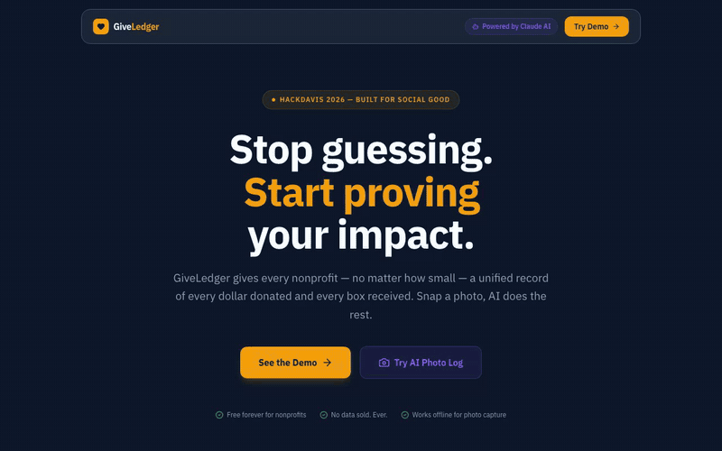

# GiveLedger

<p align="center">
  
</p>

AI-powered donation tracking for small nonprofits.

GiveLedger helps nonprofits record both financial gifts and physical donations in one place. Volunteers can log money manually, import CSV exports from common donation platforms, or snap a photo of donated goods and let Claude suggest the category, quantity, condition, and fair-market estimate before a human confirms the record.

## Hackathon Context

Built for HackDavis 2026, Social Good track.

Small nonprofits often receive a mix of checks, online gifts, food, clothing, hygiene kits, and other in-kind donations. Financial gifts may live in payment processors, while physical donations are often tracked in spreadsheets or on paper. That makes impact reporting harder when applying for grants, updating donors, or briefing a board.

GiveLedger turns those scattered records into an auditable impact ledger.

## Core Demo Flow

1. Open the landing page and frame the nonprofit pain point.
2. Visit `/dashboard` to show total raised, physical value, trend data, category split, and recent activity.
3. Log a financial donation from `/log/financial`.
4. Log a physical donation from `/log/physical` by uploading or capturing a photo.
5. Confirm the AI-suggested values before saving.
6. Visit `/history` to show the combined donation record.
7. Optionally visit `/import` to preview CSV import support.

## Demo Script

Use [`DEMO_SCRIPT.txt`](./DEMO_SCRIPT.txt) for the two-person live presentation script, suggested timing, click path, and backup Q&A lines.

## Features

- AI photo analysis for physical donations using Anthropic Claude
- Manual financial donation logging
- CSV import preview for PayPal, DonorSupport, GiveSmart, eTapestry/Blackbaud, and generic CSVs
- Supabase-backed donation storage
- Impact dashboard with totals, trends, categories, and recent activity
- Demo-mode fallbacks so judges can explore the app even when external services are not configured
- Human confirmation step for AI suggestions

## Tech Stack

- Next.js App Router
- React
- TypeScript
- Tailwind CSS
- Supabase
- Anthropic API
- Recharts
- Lucide icons

## Local Setup

```bash
npm install
npm run dev
```

Then open:

```text
http://localhost:3000
```

## Environment Variables

The app can run in demo mode without these values, but live storage and real image analysis require them:

```text
NEXT_PUBLIC_SUPABASE_URL=
NEXT_PUBLIC_SUPABASE_ANON_KEY=
SUPABASE_SERVICE_ROLE_KEY=
ANTHROPIC_API_KEY=
```

## Supabase Table

Run this SQL in Supabase before using live data:

```sql
create table donations (
  id uuid default gen_random_uuid() primary key,
  org_id text not null default 'demo-org-food-for-all',
  type text not null check (type in ('financial', 'physical')),
  amount numeric,
  currency text default 'USD',
  source text,
  donor_name text,
  notes text,
  photo_url text,
  category text,
  subcategory text,
  quantity numeric,
  unit text,
  condition text,
  estimated_value_usd numeric,
  ai_analysis jsonb,
  human_confirmed boolean default true,
  donated_at timestamptz default now(),
  created_at timestamptz default now()
);
```

## Deployment Notes

The current app lives at the repository root. In Vercel:

- Framework Preset: `Next.js`
- Root Directory: leave blank
- Build Command: default
- Output Directory: default
- Install Command: default

## What We Would Build Next

- Authentication and organization accounts
- Role-based access for volunteers, admins, and auditors
- Exportable impact reports for grants and donor updates
- More robust CSV mapping with editable column matching
- Durable photo storage for donation evidence
- Audit trail showing AI suggestion, human edits, and final confirmed values
- Multi-location inventory and distribution tracking
